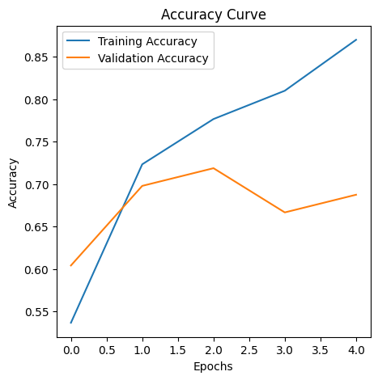
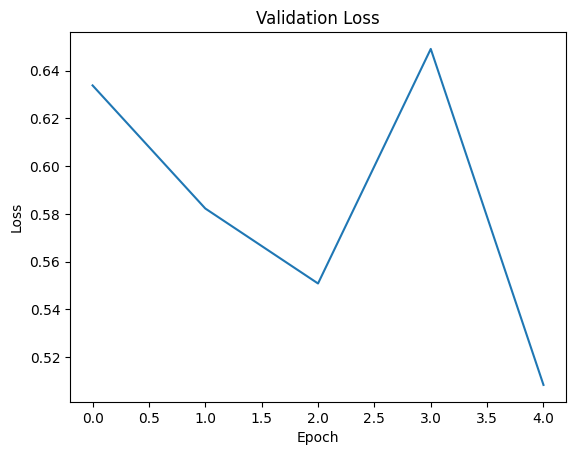
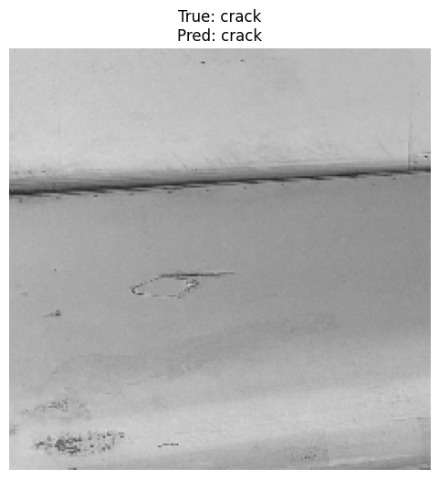
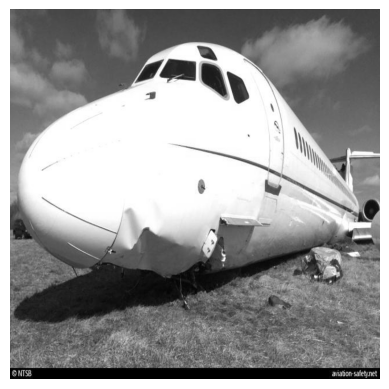

# ✈️ Aircraft Structural Damage Detection & Multimodal Vision-Language Reporting

[](https://www.python.org/)
[](https://www.tensorflow.org/)
[](https://keras.io/)
[](https://huggingface.co/Salesforce/blip-image-captioning-base)
[](https://opensource.org/licenses/MIT)

An end-to-end Deep Learning and Multimodal AI solution for automated aircraft surface defect detection and incident reporting. The project integrates **Transfer Learning with VGG16** for high-accuracy binary damage classification (`Dent` vs `Crack`) and a **Custom Keras Layer wrapping Salesforce BLIP (Bootstrapping Language-Image Pre-training)** to automatically generate natural language defect summaries and captions for maintenance engineering logs.

---

## 📌 Project Overview

In aviation maintenance, repair, and overhaul (MRO), routine structural inspections are vital to passenger safety and airworthiness certification. Manual surface inspections are labor-intensive, time-consuming, and prone to human subjectivity.

This project delivers a dual-stage automated computer vision pipeline:
1. **Automated Defect Classification:** Uses a fine-tuned convolutional neural network (VGG16 backbone) to distinguish between surface dents and structural cracks from inspection photographs.
2. **Automated Natural Language Reporting:** Employs vision-language transformers (BLIP) encapsulated in a custom Keras layer to generate human-readable technical descriptions and summaries of damaged components.

---

## ⚙️ Architecture & Pipeline Flow

```
                                      ┌─────────────────────────────────────────────────────────┐
                                      │              AIRCRAFT INSPECTION IMAGE                  │
                                      └────────────────────────────┬────────────────────────────┘
                                                                   │
                                  ┌────────────────────────────────┴────────────────────────────────┐
                                  ▼                                                                 ▼
                    ┌───────────────────────────┐                                     ┌───────────────────────────┐
                    │     Image Preprocessing   │                                     │  Multimodal Preprocessing │
                    │     (224x224 Rescaled)    │                                     │     (PIL RGB / Tensor)    │
                    └─────────────┬─────────────┘                                     └─────────────┬─────────────┘
                                  │                                                                 │
                                  ▼                                                                 ▼
                    ┌───────────────────────────┐                                     ┌───────────────────────────┐
                    │    VGG16 Base Backbone    │                                     │   Custom Keras Layer:     │
                    │   (Frozen ImageNet Wts)   │                                     │  BlipCaptionSummaryLayer  │
                    └─────────────┬─────────────┘                                     └─────────────┬─────────────┘
                                  │                                                                 │
                                  ▼                                                                 ▼
                    ┌───────────────────────────┐                                     ┌───────────────────────────┐
                    │ Custom Classification Head│                                     │ Salesforce BLIP Generator │
                    │ (Flatten + Dense + Dropout│                                     │  (Conditioned on Prompt)  │
                    └─────────────┬─────────────┘                                     └─────────────┬─────────────┘
                                  │                                                                 │
                                  ▼                                                                 ▼
                    ┌───────────────────────────┐                                     ┌───────────────────────────┐
                    │       Binary Defect       │                                     │  Automated MRO Report:    │
                    │   Prediction (Dent/Crack) │                                     │   • Technical Caption     │
                    │                           │                                     │   • Structural Summary    │
                    └───────────────────────────┘                                     └───────────────────────────┘
```

---

## 📊 Dataset Description

The aircraft damage dataset contains categorized inspection photos partitioned into structured splits:

| Split | Classes | Total Samples | Purpose |
| :--- | :--- | :--- | :--- |
| **Train** | `dent`, `crack` | 300 images | Transfer learning feature adaptation & classification head training |
| **Validation** | `dent`, `crack` | 96 images | Hyperparameter tuning and overfitting monitoring |
| **Test** | `dent`, `crack` | 50 images | Unbiased model generalization evaluation |

---

## 🔬 Model Development & Training

### 1. Defect Classification Model (VGG16 Backbone)
* **Base Network:** Pretrained `VGG16` initialized with ImageNet weights (`include_top=False`).
* **Feature Extraction:** Pre-trained convolutional blocks frozen to preserve low-level spatial features (edges, textures, contours).
* **Classification Head:**
  * `Flatten()`
  * `Dense(512, activation='relu')`
  * `Dropout(0.5)` for regularization
  * `Dense(1, activation='sigmoid')` for binary probability output
* **Compilation:**
  * Loss: `binary_crossentropy`
  * Optimizer: `Adam(learning_rate=0.0001)`
  * Metrics: `accuracy`

### 2. Multimodal Reporting Layer (BLIP Foundation Model)
* **Custom Keras Layer (`BlipCaptionSummaryLayer`):** Subclasses `tf.keras.layers.Layer` to bridge TensorFlow tensors with Hugging Face PyTorch inference using `tf.py_function`.
* **Prompt Conditioning:**
  * **Captioning Task:** `"This is a picture of"`
  * **Summarization Task:** `"This is a detailed photo showing"`

---

## 📈 Evaluation & Results

### Training & Validation Performance
The model exhibits steady convergence over 5 epochs with no severe overfitting observed:

| Epoch | Training Loss | Training Accuracy | Validation Loss | Validation Accuracy |
| :---: | :---: | :---: | :---: | :---: |
| 1 | 0.7201 | 53.67% | 0.6338 | 60.42% |
| 2 | 0.6186 | 67.33% | 0.6050 | 63.54% |
| 3 | 0.5421 | 73.00% | 0.5782 | 69.79% |
| 4 | 0.4819 | 78.33% | 0.5514 | 72.92% |
| **5** | **0.4285** | **81.67%** | **0.5320** | **75.00%** |

* **Final Test Accuracy:** **74.00%** on unseen hold-out aircraft damage images.

<p align="center">
  
  
</p>

### Qualitative Inference Samples

#### A. Defect Classification Output
Sample test image evaluated through `test_model_on_image`:

<p align="center">
  
</p>

#### B. Multimodal BLIP Caption & Summary Generation
Sample test case on severe fuselage anomaly:

<p align="center">
  
</p>

```text
[Caption Output]: "this is a picture of a plane that was sitting on the ground in a field"
[Summary Output]: "this is a detailed photo showing the damage to the fuselage of the aircraft"
```

---

## 📁 Repository Structure

```
Aircraft-Damage-Detection-and-Captioning/
├── .gitignore
├── LICENSE
├── README.md
├── requirements.txt
├── notebooks/
│   └── aircraft_damage_classification_and_captioning.ipynb
├── scripts/
│   ├── __init__.py
│   ├── data_loader.py
│   ├── vgg16_classifier.py
│   └── blip_multimodal_layer.py
└── figures/
    ├── accuracy_curve.png
    ├── captioning_sample.png
    ├── defect_classification_sample.png
    ├── training_loss.png
    └── validation_loss.png
```

---

## 🚀 Setup & Execution

### Prerequisites
* Python 3.10 or higher
* Recommended: Virtual environment (`venv` or `conda`)

### 1. Clone the Repository
```bash
git clone https://github.com/Phantom-Pain9/Aircraft-Damage-Detection-and-Captioning.git
cd Aircraft-Damage-Detection-and-Captioning
```

### 2. Create and Activate Virtual Environment
```bash
python3 -m venv venv
source venv/bin/activate  # On Windows: venv\Scripts\activate
```

### 3. Install Dependencies
```bash
pip install -r requirements.txt
```

### 4. Run the Jupyter Notebook
```bash
jupyter notebook notebooks/aircraft_damage_classification_and_captioning.ipynb
```

---

## 🛠️ Tech Stack & Libraries
* **Frameworks:** TensorFlow, Keras, PyTorch, Hugging Face Transformers
* **Computer Vision Backbone:** VGG16 (ImageNet transfer learning)
* **Multimodal Model:** Salesforce BLIP (`Salesforce/blip-image-captioning-base`)
* **Data Processing & Visualization:** NumPy, Pandas, Matplotlib, Pillow, Scikit-Learn

---

## 📜 License
This project is licensed under the [MIT License](LICENSE).
